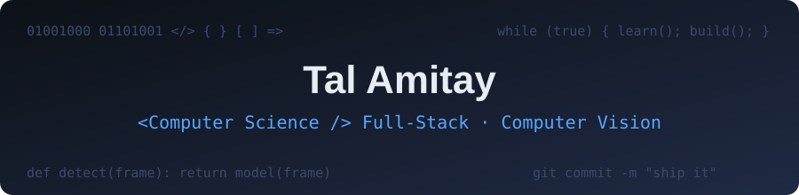

  

# Hi, I'm Tal Amitay 👋

Computer Science student at Bar-Ilan University (graduating April 2027) and Full-Stack developer.
I enjoy building end-to-end systems, from mobile apps to cloud backends to computer-vision models.

## 🚗 Featured project: RoadGuard – AI Traffic Violation Detection

RoadGuard turns everyday Android phones into dashcams and automatically detects traffic violations
(solid-line crossing, speeding, yellow-line driving). Every detection goes to a human reviewer
before any action is taken.

- **Computer vision:** YOLOv8 detection, BoT-SORT tracking, GPS/IMU speed estimation, licence-plate recognition
- **Model training:** three custom models, for lane markings, licence plates and tires
- **Backend and cloud:** Node.js/Express, MongoDB, Cloudflare R2 presigned uploads
- **Clients:** Android app (Java) and a React authority dashboard

▶️ [Watch the demo](https://www.youtube.com/watch?v=W7jFbPoyRSk) · 💻 [Source code](https://github.com/nir-b-a/Road-Guard)

## 📧 Gmailish

A full-stack Gmail-style email platform (Android, React, Node.js, C++).

💻 [Android and server](https://github.com/yuvaltar/Gmailish) · 🌐 [Web client](https://github.com/yuvaltar/Gmailish-web)

## 🛠 Skills

Python · Java · JavaScript · C/C++ · Node.js · React · MongoDB · SQL · PyTorch · OpenCV · Docker · Git

## 📫 Contact

[LinkedIn](https://www.linkedin.com/in/tal-amitay21/)
